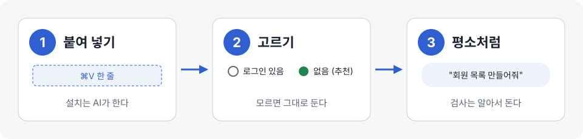
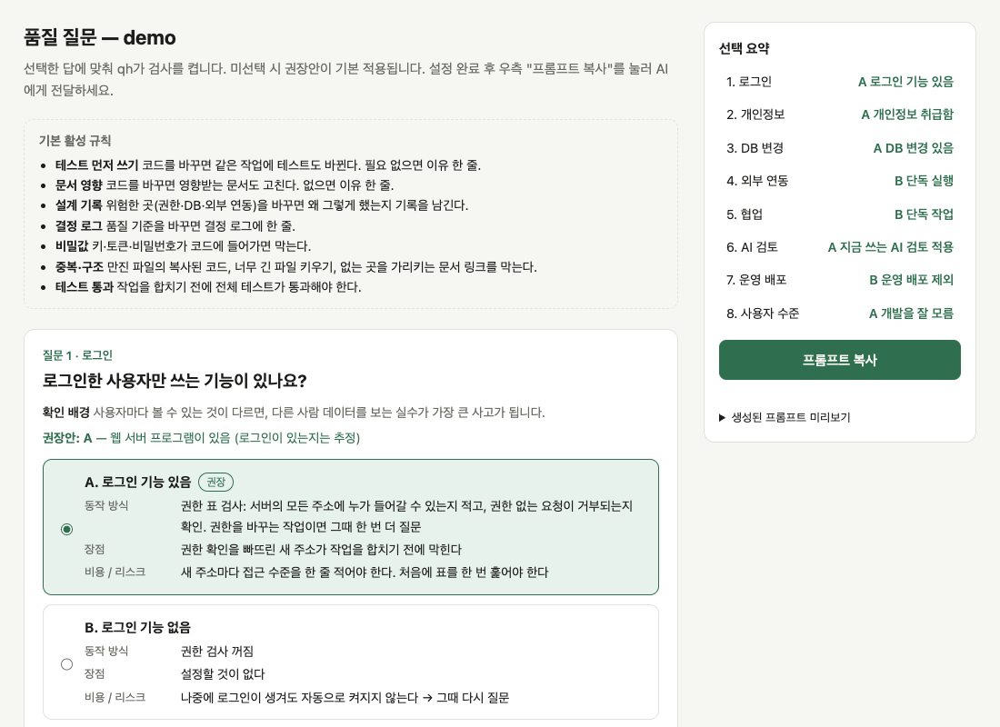
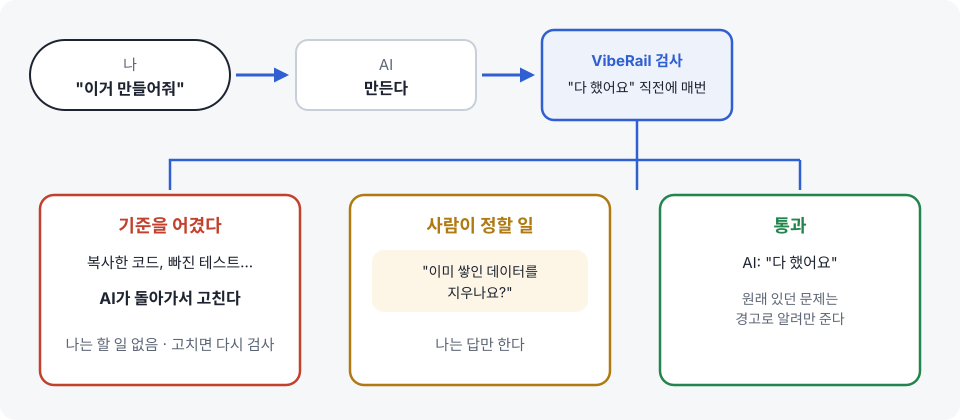
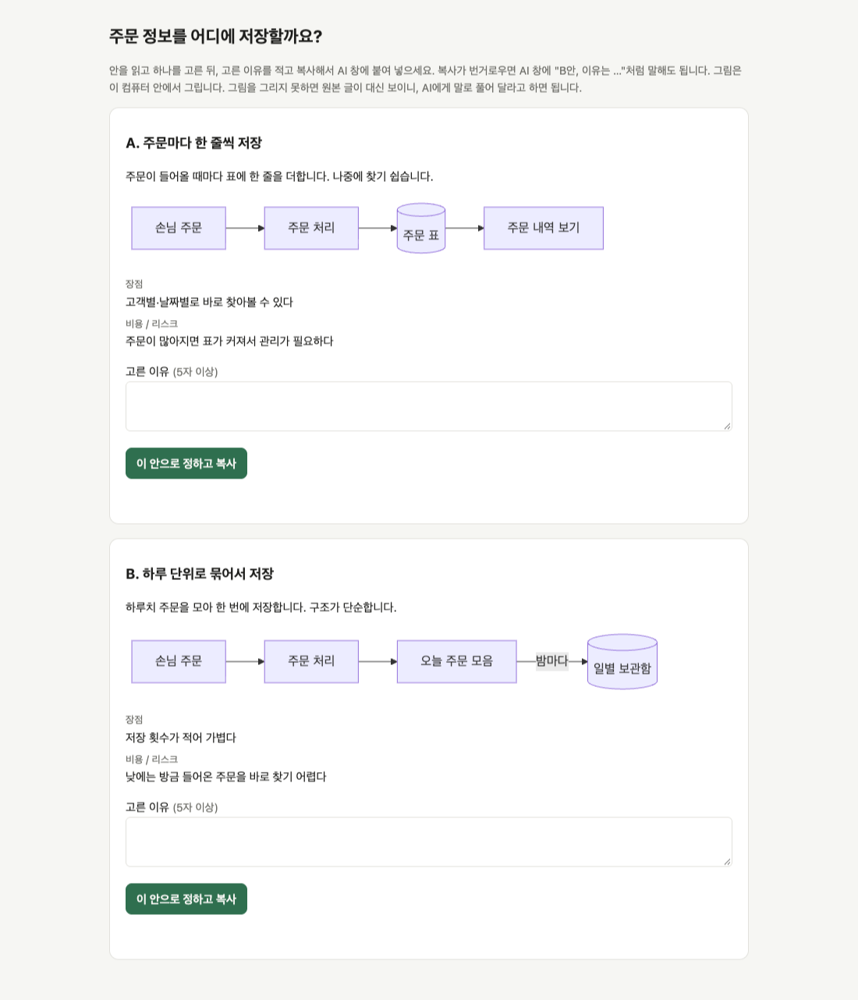
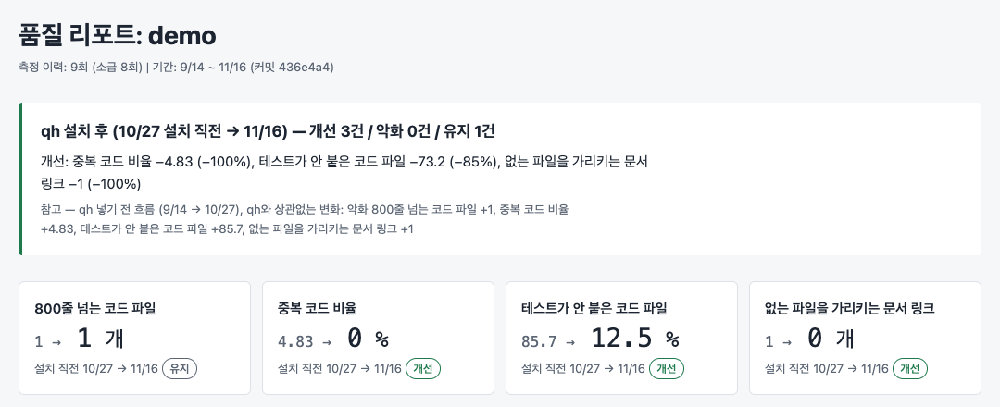

# VibeRail

**AI가 코딩을 망치기 전에 막아 줍니다. 개발 몰라도 됩니다.**



## 1. 이 한 줄을 AI 대화창에 붙여 넣으세요

```text
https://github.com/HaeDalWang/VibeRail 을 ~/VibeRail 에 받고(이미 있으면 그대로 써), ~/VibeRail/INSTALL.md 를 읽고 그대로 이 프로젝트에 설치해줘.
```

Claude Code나 Kiro에서 내 프로젝트를 연 다음에 붙여 넣으면 됩니다.

## 2. 이 화면이 뜨면 고르세요



모르면 그대로 두고 **프롬프트 복사** → AI 대화창에 붙여 넣기.

## 3. 그다음은 평소처럼 시키면 됩니다



## 4. AI가 안을 그림으로 보여 주면 하나 고르세요



마음에 드는 안을 고르고 이유를 한 줄 적어 붙여 넣으면 됩니다. AI 창에 "B안, 이유는 …"처럼 말해도 됩니다.

## 5. "품질 리포트 보여줘"라고 하면



깔기 전과 지금, 숫자가 얼마나 달라졌는지 보입니다.

---

| 이럴 때 | AI에게 |
|---|---|
| 새 기능을 만들고 싶다 | 하고 싶은 일을 말한다 (AI가 먼저 묻고, 안을 그림으로 보여 주면 하나 고르고 이유를 한 줄 적는다) |
| 상태가 궁금하다 | `품질 리포트 보여줘` |
| AI가 구조 점검할 때라고 한다 | `구조 점검하자` (후보 그림을 보고 하나 고르고 이유를 한 줄 적는다) |
| "환경 오류"라고 한다 | `이거 해결해줘` |
| 그만 쓰고 싶다 | `VibeRail 지워줘` (설치가 더한 것만 걷어내고, 내 파일과 기록은 남겨요) |

VibeRail 자체는 아무것도 올리지 않지만, 쓰는 AI 서비스(AI 검토 포함)에는 코드가 전달됩니다. 개발자용 설명: [사용 설명서](docs/reference.md) · [구조](docs/architecture.md)
