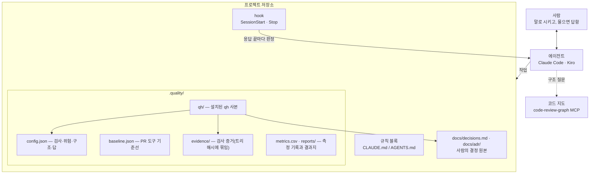
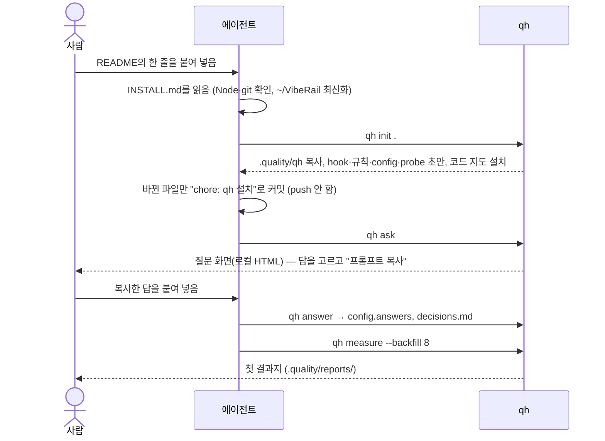
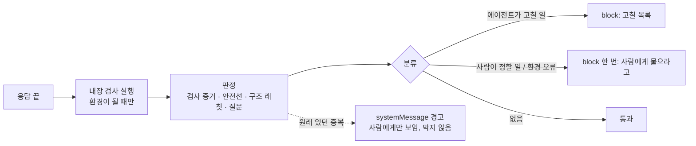
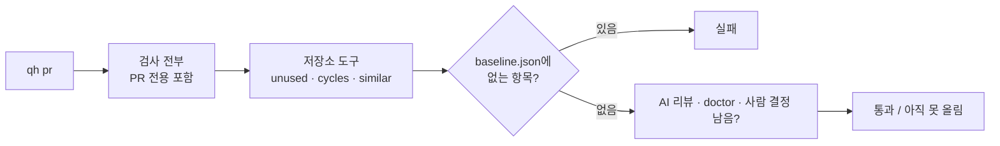

# VibeRail(qh) 구조

AI 에이전트가 일을 끝내려 할 때마다 정해진 기준을 확인한다. 기준에서 벗어나면 끝내지 못하게 돌려보내고, 사람이 정할 일은 사람에게 묻는다.
이 문서는 각 부분이 무엇을 하는지, 그리고 어느 파일에 있는지 설명한다. 명령과 설정 키 목록은 [reference.md](reference.md)에 있다.

## 한눈에

| 층 | 무엇 | 파일 |
|---|---|---|
| 연결 | 설치, hook·규칙 붙이기, 설정 초안 | `lib/init.js`, `lib/agents-snippet.md` |
| 판정 엔진 | 바뀐 것 계산, 검사 실행·증거, 분류(에이전트가 고칠 일 / 사람 / 환경) | `bin/qh.js` |
| 항상 켜진 안전선 | 테스트·문서 동반, 위험 변경 ADR, 기준 변경 로그, 비밀값 | `lib/policy.js` |
| 구조 래칫 | 만진 파일 기준: 큰 파일, 중복, 루트 파일, 문서, 함수 모양 | `lib/structure.js`, `lib/code-shape.js` |
| PR 도구 | 저장소 전체: 미사용, 순환 참조, 비슷한 함수 vs 기준선 | `lib/repo-tools.js` |
| 내장 검사 | 권한 표, SQL 스키마 대조 (프로젝트 probe로 실행) | `lib/route-access.js`, `lib/sql-prepare.js`, `lib/probe.js`, `lib/run-builtin.js` |
| 질문 | 제품 성격 질문 → 켜지는 검사, 답 저장 | `lib/questions.js`, `lib/ask.js`, `lib/ask-guide.md` |
| 점검 | 설치·설정이 실제로 작동할 수 있는지 | `lib/doctor.js` |
| 측정 | 지표 기록과 결과지 | `lib/measure.js`, `lib/measure-page.js` |
| AI 리뷰 | 변경 리뷰(보고만) | `lib/review-task.md`, `bin/qh.js` review |

## 흐름 1 — 설치 (붙여 넣기 한 번)

- `init`은 사람이 쓴 것을 덮어쓰지 않는다. 커밋 안 된 변경이 있는 파일을 만나면 멈춘다.
- 지우기는 설치 커밋을 `git revert`로 되돌린다.

## 흐름 2 — 작업마다 (Stop hook)

에이전트가 응답을 끝내려 할 때마다 실행된다. 빨라야 하므로 **바뀐 파일만** 본다. 비교 기준은 `config.baseRef`와의 merge-base다.

- **증거**: 검사 결과는 작업 트리 해시에 묶여 `.quality/evidence/`에 남는다. 파일이 바뀌면 증거가 낡은 것이 되어 다시 돌려야 한다. 측정 기록(`metrics.csv`, `reports/`)은 해시에서 빠진다.
- **반복 막기 상한**: 상태는 세션별로 `.quality/evidence/stop-state.json`에 둔다. 에이전트가 아무것도 바꾸지 않았는데 같은 이유로 다시 Stop하면 막지 않는다. 코드를 바꿔도 같은 항목이 연속 2번 막혔으면 그 항목은 그만 막고 사용자에게 쉬운 말로 한 번 알린다. 사람에게 물을 일은 내용당 한 번만 묻는다. 에이전트가 같은 이유에 갇히지 않게 하려는 것이다.
- **Kiro처럼 한 번에 끝나는 호스트**: 막는 이유에 다시 확인할 명령과 사용자에게 전할 말을 함께 넣고, 전하지 못한 알림은 다음 세션 시작 때 다시 보여 준다.
- **라우트 답**: 권한 표에 새 라우트 줄이 생겨도 qh가 그 라우트를 사용자에게 물은 적이 있을 때만 답으로 친다. 묻지 않고 넣은 줄은 기준 변경으로 남아 사람이 확인한다.
- **qh 자체 오류**: 경고만 하고 막지 않는다(exit 1).

### 구조 래칫 (`config.structure`, 설정한 것만)

저장소 전체 합계로 판정하지 않는다. 합계로 보면 한 곳을 정리한 몫으로 다른 곳의 새 복사가 가려지고, 어디를 고칠지 가리킬 수도 없기 때문이다. 이번 작업이 만진 파일을 base와 비교한다.

| 규칙 | 막는 것 |
|---|---|
| 큰 파일 (항상) | 800줄 넘는 코드 파일이 더 커짐 (테스트 파일 포함) |
| 중복 (항상) | 만진 파일 안의 6줄(기본값, `limits.duplicateLines`) 이상 복사 덩어리가 base보다 늘어남. 원래 있던 것은 막지 않고 아키텍처 점검 후보 경고(ADR 0001) |
| 죽은 링크 (항상) | 바뀐 문서의 없는 파일 링크 |
| 맨 위 새 파일 (항상) | 저장소 맨 위에 새 파일 (`루트 파일:` 이유가 있으면 통과) |
| `flatRoots` | 지정 폴더 바로 아래 새 파일 |
| `noGrow` | 지정 문서가 줄·바이트로 커짐 |
| `forbidden` | 지정 폴더 아래 새 파일 |
| `patterns` | 문서(코드 블록 밖)·주석에서 매치 수 증가 |
| `backtickRefs` | 바뀐 문서의 백틱 경로가 없음, 지운 파일을 가리키던 문서 |
| `functions` | 함수 길이·복잡도·중첩·인자·콜백 한도 초과 함수 추가 (프로젝트의 ESLint로 읽음) |

예외는 `docs/decisions.md`에 이유를 적는 한 줄이다(`중복 허용:`, `루트 파일:` 등). 기준이 바뀌는 것이므로 사람이 PR에서 본다.

## 흐름 3 — PR 직전 (`qh pr`)

- 저장소 전체 도구는 몇 초에서 몇 분이 걸린다. Stop에 두기엔 느려서 PR에서만 돌린다.
- 항목마다 고정 ID가 있다. 기준선에 없는 ID가 생기면 실패한다. 기준선을 늘리는 것(`qh baseline`)은 기준 변경이라 사람에게 간다.
- CI에서는 `qh status --pr --base <ref>`로 비교할 ref를 넘긴다.

## 흐름 4 — 측정 (`qh measure`)

- 한 번 잴 때마다 `.quality/metrics.csv`에 한 행을 더한다. 행은 지우지 않는다.
- 결과지는 `.quality/reports/<날짜>-<커밋>.html`로 쌓인다. 로컬 파일이고, 외부에서 불러오는 것이 없다.
- `--backfill <주>`는 버리는 clone에서 지난 주마다 커밋 하나씩을 잰다. 작업 저장소는 건드리지 않는다.

| 판정 지표 (줄면 개선) | 단위 | 수용 방법 |
|---|---|---|
| 800줄 넘는 코드 파일 | 개수 | 래칫(더 키우지 않기) |
| 중복 비율 | 코드 줄 대비 % | `중복 허용:` 줄은 측정에서 뺌 |
| 테스트 없는 코드 파일 | % | `테스트 없음 허용:` 줄은 분자·분모에서 뺌 |
| 죽은 문서 링크 | 개수 | 없음 (0이어야 함) |
| 평평한 루트 파일 | 개수 | `flatRoots`를 설정한 프로젝트만. `루트 파일:` 예외 제외 |

참고 지표로 결정 로그 줄 수, ADR 수, 기능당 수정 파일 수, Stop 차단 횟수, 규모를 보여 주지만 판정하지는 않는다. 비교 기준점은 qh를 처음 커밋하기 직전 커밋이다. 측정 규칙 버전(`rules`)이 같은 행끼리만 비교한다. `vendor/`·`third_party/`·`node_modules/`는 세지 않는다.

## 원칙

- **바뀐 것만 본다**: Stop은 만진 파일만 본다. 저장소 전체는 PR과 측정이 맡는다.
- **덮어쓰지 않는다**: 사람이 쓴 설정·결정 로그·권한 표는 qh가 덮어쓰지 않는다.
- **분류해서 돌려보낸다**: 코드 문제는 에이전트에게, 결정은 사람에게, 도구·환경 문제는 "코드 바꾸지 말고 보고"로 돌려보낸다.
- **로컬에서만 돈다**: 질문 화면·결과지·증거는 이 컴퓨터에만 있고 외부로 보내지 않는다.
